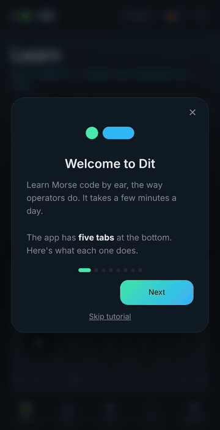

# Dit — Morse Trainer

[](https://bitdaemon.github.io/morse-trainer/)
[](LICENSE)

<p align="center"></p>

A sleek, offline-capable Progressive Web App for learning Morse code by ear. No build step, no dependencies, no account. It's plain HTML, CSS and JavaScript.

## Features

- **Welcome tutorial**: an 8-step guided tour on first launch. Reopen it any time with the **?** button or from Settings.
- **Learn**: Koch-method introduction, one character at a time, with animated dit/dah patterns and a progress grid.
- **Copy**: listen and type what you hear. Characters you miss come up more often, and new letters unlock as your accuracy improves.
- **Send**: a straight key (tap the button or hold Space) with live decoding of your timing.
- **Tree**: an interactive Morse dichotomic tree that lights your path as you key. Tap any letter to hear it.
- **Settings**: character speed, Farnsworth spacing, tone, volume, group length, adjustable unlock rules and 9 colour themes.
- **Installable & offline**: add it to your home screen or dock, and it works without a connection.

## How to use

| Tab | What you do |
|---|---|
| **Learn** | Press **▶ Play** to hear the current letter, and **‹ ›** to move between letters. Listening only. |
| **Copy** | Press **Start**, click the *Type here…* box and type the letter you heard. No Enter needed. |
| **Send** | Hold **Space** or the round key. A short press is a dit, a long press is a dah. Pause to end a letter. |
| **Tree** | Key with Space and follow your path, or tap a letter to hear it. Circle = dit, bar = dah. |
| **Settings** | Adjust speed, sound, unlocking rules and theme. |

### Unlocking letters
You start with **K** and **M**. A new letter unlocks on the **Copy** tab once every unlocked letter meets the unlock rules. By default that's **90% accuracy over its last 20 attempts, with at least 10 attempts**. All three values can be changed in Settings.

### Tips
- Beginners should set **Character speed to 10–12 WPM** for the Send tab; the timing is much more forgiving.
- A good routine is a few minutes on Learn, then 10 minutes of Copy, every day.

## Themes
Midnight · Daylight · Phosphor · Amber CRT · Nord · Dracula · Ocean · Sunset · Mono

## Try it

**Live:** <https://bitdaemon.github.io/morse-trainer/>. Open it on your phone and use *Add to Home Screen* to install it as an app.

## Run locally

```bash
git clone https://github.com/bitdaemon/morse-trainer.git
cd morse-trainer
python3 -m http.server 8000
```

Open <http://localhost:8000>. Use a local server rather than opening `index.html` directly, because the service worker (offline mode and install) needs `http://`.

After pulling an update, hard-refresh (**Cmd/Ctrl+Shift+R**) so the browser doesn't serve the old version from its offline cache.

## Project structure

```
index.html            App shell and markup for all tabs
styles.css            Layout, components and colour themes
app.js                Audio engine, Learn / Copy / Send, settings, themes
tree.js               Interactive Morse tree
tutorial.js           First-run welcome tutorial
sw.js                 Service worker (offline cache)
manifest.webmanifest  PWA manifest
icon.svg              App icon
```

Progress and settings are stored in the browser's `localStorage`; nothing leaves the device.

## Browser support
Current Chrome, Edge, Safari and Firefox (desktop and mobile). It requires the Web Audio API and CSS `color-mix()`.

## License

[MIT](LICENSE) © 2026 bitdaemon

## A note on how this was built

This is a vibe-coded project. I designed what it should do (the Koch-method lesson flow, how letters unlock, the Send and Tree tabs, the themes and the first-run tutorial) and I tested it by hand in my own browser, but most of the code was written with an AI assistant. It hasn't had a professional code review, and there's no automated test suite yet. If you spot something off, please [open an issue](https://github.com/bitdaemon/morse-trainer/issues).
